# Шагай наадан — Мори урилдаан

Игра на Python, посвящённая бурятской национальной игре **«Шагай наадан»** — игре в бараньи
косточки-шагай. Главный режим — **«Мори урилдаан» (скачки)**: бросаете пять косточек, и сколько
из них встало боком («морин», конь), на столько костей скачет ваш конь. Кто первым пройдёт
ипподром из 12 шагай — победил.

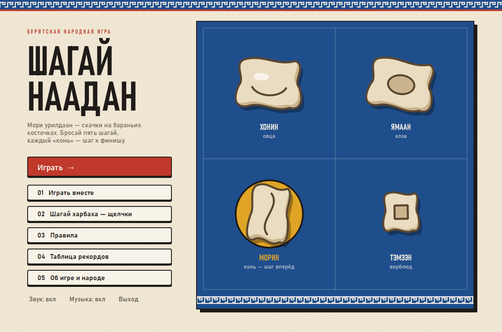

## Быстрый старт

**Без Python (Windows):** скачайте архив `ShagaiNaadan-windows.zip` из раздела
[Releases](../../releases), распакуйте и запустите `ShagaiNaadan.exe`.

**Из исходников** (нужен Python 3.10+):

```bash
pip install -r requirements.txt
python main.py
```

При первом заезде игра сама покажет подсказки: что где на экране и как бросать.

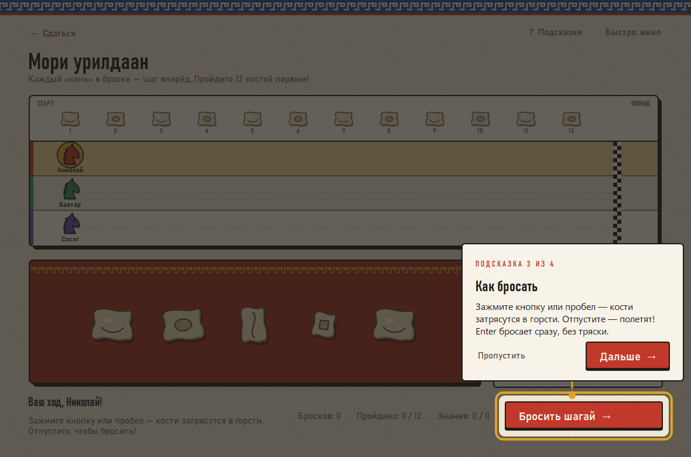

Если звук на компьютере работает с ошибками, запустите игру без звука:
`set SHAGAI_NO_SOUND=1` (Windows) или `export SHAGAI_NO_SOUND=1` (Linux/macOS), затем `python main.py`.

## Как играть

1. В меню нажмите **«Играть»**, впишите имя, выберите соперников и длину заезда.
2. **Зажмите** кнопку «Бросить шагай» (или пробел) — кости затрясутся в горсти, кольцо покажет силу.
   **Отпустите** — пять шагай полетят по войлоку.
3. Кости, вставшие **боком**, — это **«морин» (конь)**. Сколько коней, на столько костей скачет ваш конь.
4. Соперники бросают по очереди с вами. Кто первым пройдёт все кости — победил!

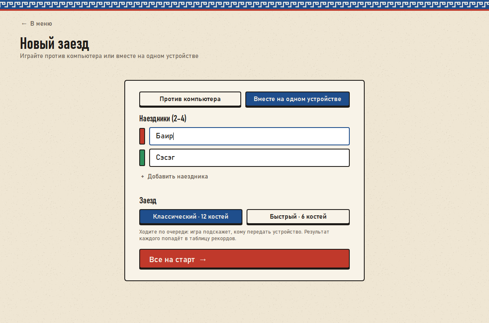

| Сторона шагая | Перевод | Как лежит кость | В скачках |
|---|---|---|---|
| Хонин | овца | выпуклой стороной вверх | — |
| Ямаан | коза | вогнутой стороной вверх | — |
| **Морин** | **конь** | **стоит боком** | **+1 шаг** |
| Тэмээн | верблюд | стоит на торце | — |

Вероятности сторон близки к настоящей кости: «конь» выпадает примерно в 1 случае из 8.

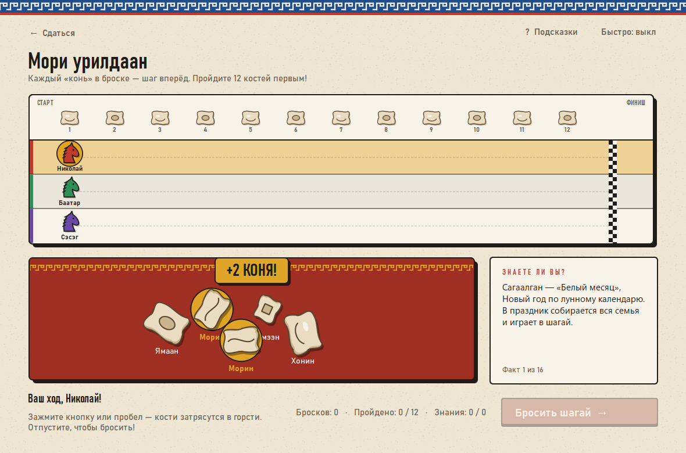

## Возможности

### Скачки
- **Бросок «вживую»**: кости трясутся в горсти, летят, отскакивают от войлока и друг от друга,
  а выпавшие «кони» подпрыгивают. Пауза после броска — чтобы рассмотреть кости.
- **Против компьютера** (1–3 соперника) или **вместе на одном устройстве** (2–4 игрока по очереди:
  игра подсказывает, кому передать устройство).
- **Классический заезд** (12 костей) или **быстрый** (6 костей, на пару минут).
- **«Знаете ли вы?»** — новый факт о бурятах на каждом вашем ходу.
- **«Вопрос знатока»** после 2-го, 5-го и 8-го броска: верный ответ даёт +50 очков.
- **«Решающий бросок!»** за шаг до финиша: камера наезжает на коня, ход идёт в замедлении.
- **Праздник на финише**: конь пляшет в лучах солнца, звучит фанфара, сыплется дождь из хадаков.
- **Именной сертификат победителя** — A4 в PNG или PDF, с именем, очками, датой и печатью.
- **Подсказки** при первом заезде (и по кнопке «? Подсказки» в любой момент).

| Решающий бросок | Финиш |
|---|---|
| 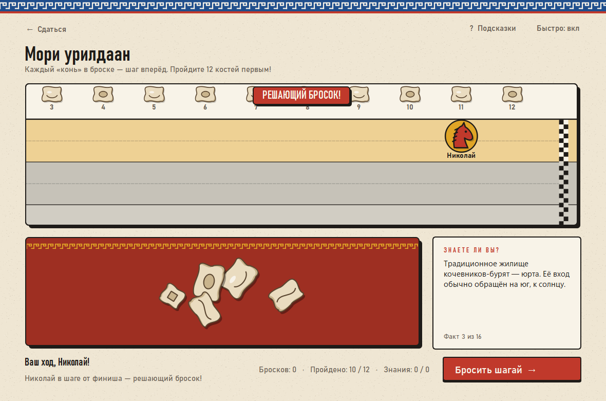 | 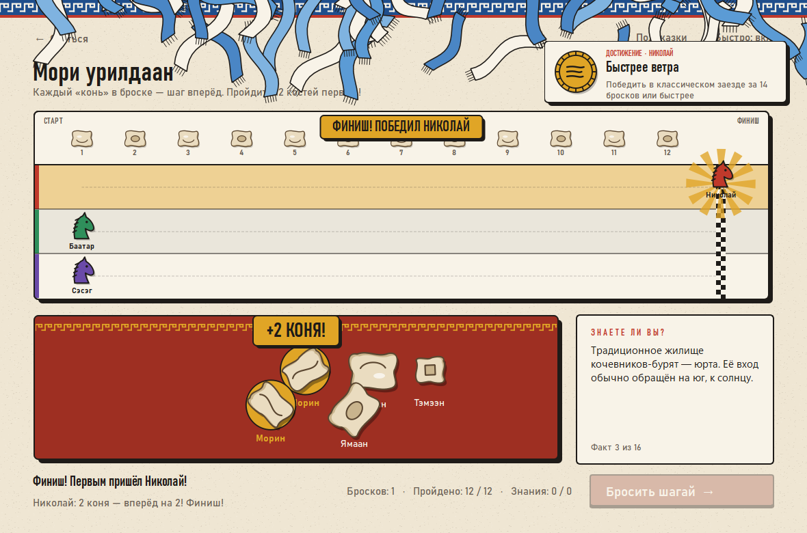 |


### Мини-игра «Шагай харбаха» (щелчки)
Тяните кость мышью, как рогатку, и отпускайте: первой нужно задеть кость **той же стороны**.
Сбитую кость вы забираете. Серии попаданий умножают очки, три промаха — конец игры,
собрали все пары — «чистый войлок» и бонус. Своя таблица лучших.

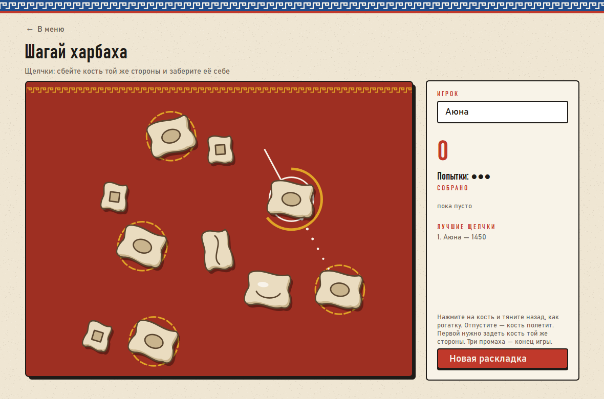

### Таблица рекордов, карточка игрока, достижения
- Результат сохраняется автоматически (SQLite).
- **Живой фильтр по имени** — без учёта регистра, с кириллицей.
- Сортировка щелчком по заголовку, **переименование** (двойной щелчок) и **удаление** записей
  с подтверждением, **экспорт в CSV** для Excel.
- **Карточка игрока**: заезды, победы, лучший результат, график очков, витрина значков.
- **9 достижений** — «Табун», «Быстрее ветра», «Знаток культуры», «Меткий щелчок» и другие —
  выезжают со звоном в момент получения.

| Рекорды | Карточка игрока |
|---|---|
| 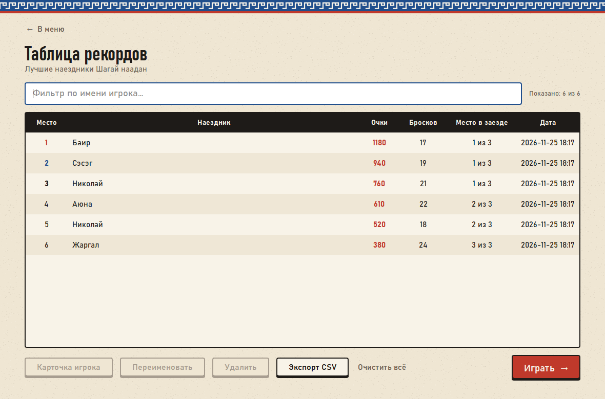 | 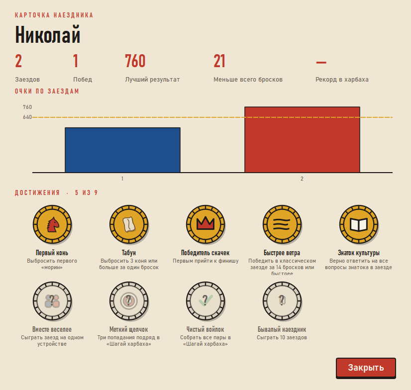 |

### «Как играть» и «Об игре и народе» — не текст, а игрушки
- Карточки-перевёртыши со сторонами шагая, пятью видами скота, праздниками и играми.
- **Пробный бросок** на учебном ипподроме, **калькулятор очков** с ползунками.
- Клавиши, которые загораются от нажатия, хоровод **ёхор** (нажмите — закружится быстрее).
- **Бурятский словарик** и мини-викторина **«Проверь себя»**.

| Как играть | Об игре и народе |
|---|---|
| 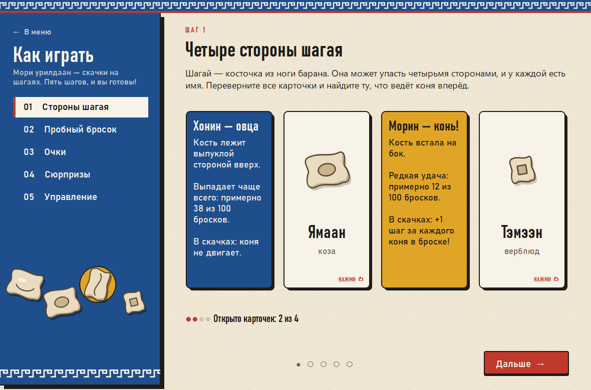 | 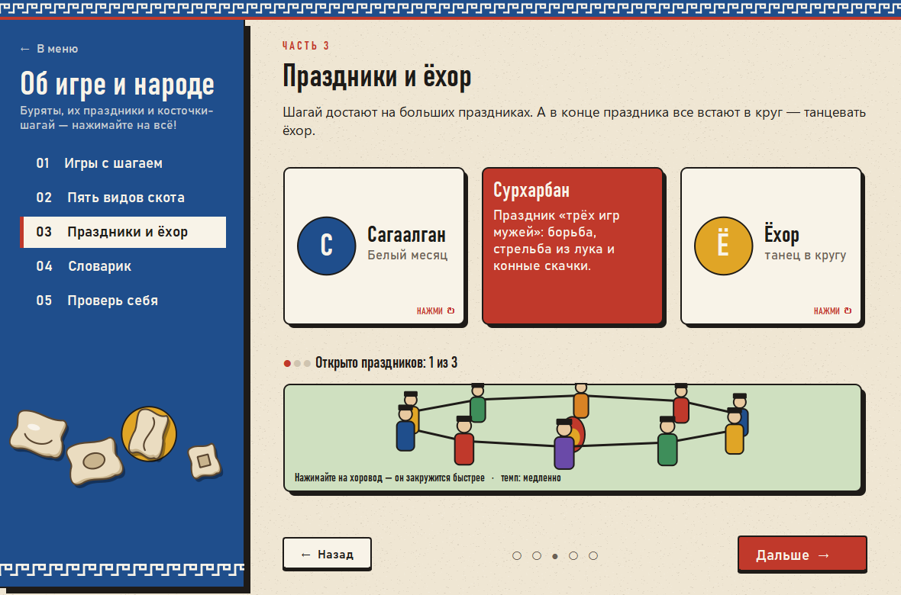 |

### Оформление
Палитра — синий (Вечное Небо), красный (огонь очага) и охра (солнце) на светлом «войлоке»,
кайма — бурятский орнамент «алхан хээ». Вся графика рисуется кодом, звуки и фоновая мелодия
в духе морин хуура синтезированы скриптом — никаких чужих картинок и музыки.
Музыку и звуки можно выключить в главном меню.

## Очки

- **50** за каждую пройденную кость;
- победа: **+400** и бонус за скорость `300 − 10 × броски` (не меньше 0);
- **+50** за каждый верный ответ на «вопрос знатока» (на ход скачек вопросы не влияют);
- каждый соперник увеличивает итог на **10 %**;
- быстрый заезд (6 костей) даёт пропорционально меньше очков, чтобы честно соседствовать
  с классическим в одной таблице.

## Обработка ошибок

- Имя проверяется «на лету»: пустое, длиннее 20 символов, недопустимые символы, без букв,
  повтор имени в игре вместе — понятное сообщение, поле подсвечивается и встряхивается.
- Параметризованные SQL-запросы (защита от SQL-инъекций), сообщения при сбое базы:
  если файл рекордов не открывается, игра продолжает работать с рекордами в памяти.
- Игра запускается без звука, если звуковая система недоступна.
- Непредвиденная ошибка показывается окном, а не «тихим» падением.

## Управление

| Клавиша | Действие |
|---|---|
| Enter | в меню — играть; в поле имени — старт; в заезде — бросить сразу |
| Пробел (зажать и отпустить) | потрясти и бросить шагай |
| Esc | назад / в меню |
| Ctrl+F | фильтр в таблице рекордов |
| Delete | удалить выбранную запись |
| Двойной щелчок | переименовать запись |

## Структура проекта

```
main.py              точка входа
core/                логика без интерфейса (покрыта тестами)
  shagai.py          правила скачек, бросок, подсчёт очков
  harbaha.py         правила мини-игры «Шагай харбаха»
  achievements.py    какие достижения за что даются
  validation.py      проверка имени игрока
  db.py              SQLite: рекорды, фильтр, экспорт, достижения, результаты харбаха
ui/                  интерфейс на PySide6 (Qt 6)
  main_window.py     окно и плавные переходы между экранами
  screens.py         меню, ввод имени, заезд, рекорды
  widgets.py         бросок с физикой, ипподром
  interactive.py     интерактивные «Как играть» и «Об игре и народе»
  harbaha.py         мини-игра: прицел-рогатка и физика щелчков
  tour.py            подсказки при первом заезде
  effects.py         дождь из хадаков, всплывающие достижения, значки
  certificate.py     сертификат победителя (PNG / PDF)
  profile.py         карточка игрока с графиком очков
  art.py             графика кодом: орнамент, кости, кони
  theme.py           палитра и стили (QSS)
  texts.py           факты и вопросы о бурятах
  sound.py           звуки и музыка (необязательны)
assets/              звуки и мелодия (tools/make_sounds.py)
docs/                скриншоты (tools/make_screenshots.py)
tests/               тесты pytest
```

## Тесты

Логика игры отделена от интерфейса, поэтому правила проверяются автоматически:

```bash
pip install pytest
python -m pytest -q
```

## Сборка .exe

```bash
pip install pyinstaller
build_exe.bat
```

Готовая программа появится в `dist/ShagaiNaadan/ShagaiNaadan.exe`.

## Технологии

Python 3 · PySide6 (Qt 6) · SQLite (`sqlite3` из стандартной библиотеки) · pytest · PyInstaller.
